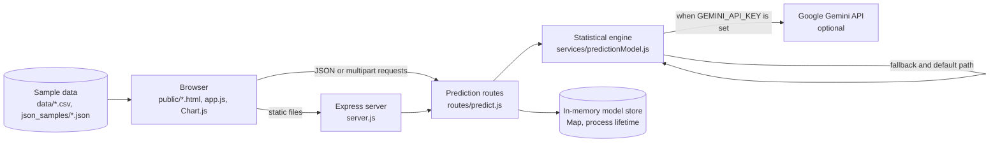

# TerraIQ (CarbonTrack AI)

[](LICENSE)
[](https://nodejs.org/)
[](https://expressjs.com/)
[](https://ai.google.dev/)

TerraIQ is a carbon-emissions forecasting dashboard that trains a statistical model from yearly company data and produces multi-year projections with confidence intervals.

> **Naming:** The product and UI are branded **TerraIQ**. The npm package is named `carbontrack-ai`, and earlier documentation used **CarbonTrack AI**. This repository is the TerraIQ backend (`ishanvaidya01/terraiq-backend`); the names refer to the same application.

## Overview

TerraIQ is a self-contained Node.js application for exploring corporate emissions trends. A static HTML/CSS/JavaScript frontend is served by an Express server, and an API trains per-company forecasting models from CSV, JSON, or sample data. Each model can generate a 1–20 year forecast, compare predictions against actual values, and report error metrics. Google Gemini is optional: when configured, it adds narrative analysis and AI-assisted predictions; without a key, the entire workflow runs in statistical mode.

The project was built as a demonstration of a complete train → forecast → compare workflow, not as a regulatory reporting system. All trained models live in server memory and are lost on restart.

## Features

- **Guided dashboard.** Demo sign-in, KPI cards, an industry-trend chart, and shortcuts into the prediction workflow.
- **Model training.** Upload CSV/JSON, paste JSON manually, or quick-load one of the built-in sample companies. At least three yearly observations are required.
- **Statistical forecasting.** Linear regression, growth-rate analysis, volatility, and a per-year efficiency decay produce 1–20 year projections with widening confidence intervals.
- **Optional Gemini enhancement.** AI analysis and prediction narratives use `gemini-2.5-flash`; failed or missing API calls fall back to statistical output.
- **Accuracy comparison.** Compare a forecast with actual yearly values and receive MAE, MAPE, accuracy score, confidence-interval coverage, a performance rating, and improvement suggestions.
- **Discrepancy analysis.** Validate a dataset and surface anomalies, either with Gemini or with statistical checks.
- **Model management.** List, inspect, and delete models for the lifetime of the server process.
- **Sample data.** Fourteen CSV files in `data/`, twenty-one JSON snapshots in `json_samples/`, and twelve quick-load datasets embedded in the frontend.
- **No database required.** Installation is `npm install`; there is no migration or external service to provision.

## Screenshots

| Sign in | Dashboard |
| :---: | :---: |
|  |  |


The dashboard cards are static presentation values; they are not computed from your data. Use the comparison screen for real metrics from a model you trained.

## Architecture



The Express server serves `public/` as static assets and mounts the API under `/api/predict`. There is no database, session store, job queue, or background worker.

## Tech Stack

| Layer | Technology |
| :--- | :--- |
| Runtime | Node.js 18+ with native ES modules |
| Server | Express 4, CORS, dotenv |
| Uploads and parsing | Multer (memory storage), csv-parser |
| Forecasting | Custom statistical model in `services/predictionModel.js` |
| AI (optional) | `@google/generative-ai`, model `gemini-2.5-flash` |
| Frontend | Static HTML, CSS, vanilla JavaScript |
| Charts | Chart.js 4.4.1 from jsDelivr |
| Fonts | Playfair Display, Inter, JetBrains Mono via Google Fonts |
| Persistence | None — trained models are held in a process-level `Map` |

## Project Structure

```text
terraiq-backend/
├── server.js                    # Express app, static hosting, health routes
├── routes/
│   └── predict.js               # Training, forecasting, comparison, analysis endpoints
├── services/
│   └── predictionModel.js       # Statistical engine and optional Gemini integration
├── public/
│   ├── login.html               # Demo sign-in page
│   ├── dashboard.html           # Overview and dataset shortcuts
│   ├── index.html               # Training, forecast, comparison, and analysis UI
│   └── app.js                   # Frontend state, API calls, and charts
├── data/                        # 14 sample CSV files (year,emissions)
├── json_samples/                # 21 JSON emission snapshots
├── Screenshots/                 # Interface screenshots used in this README
├── .env.example                 # Environment variable template (placeholders)
└── package.json                 # Scripts and dependencies
```

## Prerequisites

- **Node.js 18 or newer** and npm. `npm run dev` uses `node --watch`, available from Node.js 18.11.
- A modern browser with JavaScript enabled.
- **Optional:** a Google Gemini API key for AI-assisted analysis. Get one from [Google AI Studio](https://aistudio.google.com/app/apikey).

## Setup

### 1. Clone the repository

```bash
git clone https://github.com/ishanvaidya01/terraiq-backend.git
cd terraiq-backend
```

### 2. Install dependencies

```bash
npm install
```

### 3. Configure the environment (optional for Gemini)

```bash
# macOS / Linux
cp .env.example .env

# Windows PowerShell
Copy-Item .env.example .env
```

Set `GEMINI_API_KEY` in `.env` if you want AI-assisted output. Leave it blank or unset to use statistical mode. Never commit `.env`.

### 4. Start the application

```bash
# Production-style start
npm start

# Development with automatic restart on file changes
npm run dev
```

Open [http://localhost:5000](http://localhost:5000). You will be redirected to the demo sign-in page.

### 5. Sign in with the demo account

```text
Username: admin
Password: admin123
```

The credentials are displayed on the login page and are validated entirely in the browser. They are a demo gate, **not authentication**. Do not deploy this application with sensitive data or assume those credentials protect the API.

## Environment Variables

| Variable | Required | Default | Description |
| :--- | :---: | :--- | :--- |
| `GEMINI_API_KEY` | No | — | Google Gemini API key. When absent or invalid, the app runs in statistical mode. |
| `PORT` | No | `5000` | Port for the Express server. |
| `NODE_ENV` | No | — | Conventional Node environment label; not used for branching in the current code. |

The frontend hardcodes its API base as `http://localhost:5000/api` in `public/app.js`. If you change `PORT`, update that constant as well or the UI will keep calling port 5000.

## Run Commands

| Command | Purpose |
| :--- | :--- |
| `npm install` | Install dependencies |
| `npm start` | Start the server with `node server.js` |
| `npm run dev` | Start with `node --watch server.js` and reload on changes |
| `npm test` | Not defined — no automated test suite is configured |
| `npm run lint` | Not defined — no linter is configured |

## Usage

1. Sign in with the demo account. The browser stores `isLoggedIn` and `username` in `localStorage`; `dashboard.html` and `index.html` redirect to the login page when the flag is missing.
2. On the dashboard, note the quick-start cards. Selecting a company opens the predictor with a built-in sample dataset.
3. Open **Train Model**. Choose a sample company, upload a CSV/JSON file, or paste an array of `{ "year": 2020, "emissions": 120000 }` objects. Fill in company, industry, region, and reporting standard, then train.
4. Open **Generate Forecast**, select the trained model, and choose 1–20 years. The response includes predictions, confidence bounds, methodology, risk factors, and a chart.
5. Open **Compare Accuracy** and supply prediction and actual arrays in the same year space. The UI shows MAE, MAPE, accuracy, confidence coverage, and suggestions.
6. Open **Analyze Discrepancies** to inspect a dataset for anomalies. Gemini adds narrative findings when configured; otherwise the statistical checks run.
7. Models can be listed, inspected, or deleted from the model section. They disappear when the process restarts.

## CSV Upload Flow

Training accepts `multipart/form-data` with a `dataset` file. Multer keeps the file in memory and enforces a **10 MB** limit. Files are accepted when the MIME type is CSV, Excel, XLSX, or JSON, or when the filename ends in `.csv` or `.json`.

The CSV parser reads the first matching columns:

| Field | Accepted column names |
| :--- | :--- |
| Year | `year`, `Year`, `YEAR`, `year_reported` |
| Emissions | `emissions`, `Emissions`, `EMISSIONS`, `carbon_emissions`, `total_emissions`, `co2` |

Rows without a numeric year and emissions value are skipped. At least three valid rows are required for training; discrepancy analysis requires at least two.

```csv
year,emissions
2018,50000
2019,52500
2020,54000
2021,53000
2022,51000
2023,49000
```

To train with JSON instead, send `training_data` as an array or a JSON string. To exercise the pipeline without a file, send `use_sample=true`. The included CSVs are demonstration data; confirm any figure against the company's published disclosures before relying on it.

## API Endpoints

Base URL: `http://localhost:5000`. All prediction endpoints are JSON unless noted.

| Method | Path | Description |
| :--- | :--- | :--- |
| `GET` | `/api/status` | Health/status payload with version and service availability |
| `POST` | `/api/predict/train` | Train a model from `multipart/form-data` (`dataset`) or JSON (`training_data`) |
| `POST` | `/api/predict/forecast` | Generate a forecast for a stored model |
| `POST` | `/api/predict/compare` | Compare predictions with actual values |
| `GET` | `/api/predict/models` | List models in memory |
| `GET` | `/api/predict/models/:modelId` | Get one model's training details |
| `DELETE` | `/api/predict/models/:modelId` | Delete one model |
| `GET` | `/api/predict/sample-data` | Generate sample training data; optional `company_name` query |
| `POST` | `/api/predict/analyze-discrepancies` | Analyze a dataset; multipart `dataset` or JSON `dataset` |
| `GET` | `/api/predict/gemini-status` | Report whether Gemini is configured and reachable |

### Train

```bash
curl -X POST http://localhost:5000/api/predict/train \
  -F "company_name=Acme Ltd" \
  -F "industry=Manufacturing" \
  -F "region=Asia Pacific" \
  -F "standard=GHG Protocol" \
  -F "dataset=@data/sample_tesla.csv"
```

Minimum three data points. The response contains `model_id`, training summary, statistical features, and model context.

### Forecast

```bash
curl -X POST http://localhost:5000/api/predict/forecast \
  -H "Content-Type: application/json" \
  -d "{\"model_id\":\"model_...\",\"years_to_predict\":5}"
```

Provide either `model_id` or `company_name`. `years_to_predict` must be between 1 and 20 and defaults to 5.

### Compare

```bash
curl -X POST http://localhost:5000/api/predict/compare \
  -H "Content-Type: application/json" \
  -d "{\"predictions_json\":[{\"year\":2024,\"predicted_emissions\":48000,\"confidence_lower\":45000,\"confidence_upper\":51000}],\"actual_data\":[{\"year\":2024,\"emissions\":49000}]}"
```

If `predictions_json` is omitted, the route uses predictions stored by the last forecast for a supplied `model_id`. Actual values are matched to predictions by year.

### Errors

Validation failures return `400` with `error` and `message`. Missing models return `404`; upstream or unexpected failures return `500`. There is no API authentication layer.

## How the Model Works

The statistical engine calculates mean, minimum, maximum, average growth rate, linear-regression slope, volatility of growth rates, and a recent-versus-historical trend. Forecasts start from the last observed value, add the regression slope per year, apply a 2% annual efficiency decay (`0.98^i`), and clamp at zero. The confidence range is derived from volatility and widens by 20% per forecast year.

Comparison computes:

- **MAE** — mean absolute error in emissions units.
- **MAPE** — mean absolute percentage error.
- **Accuracy score** — `max(0, 100 - MAPE)`.
- **Confidence accuracy** — share of actual values inside the predicted interval.

The code labels accuracy ≥90 as Excellent, ≥70 as Good, and ≥50 as Fair. These are heuristics, not a guarantee of predictive validity. Statistical forecasts are reported with a model accuracy estimate of 65–75 depending on data volume; Gemini output may supply a different narrative estimate. Treat every figure as an estimate.

## Testing

There is no automated test suite, linter, or formatter in this repository, and `package.json` defines only `start` and `dev`. Verification is manual: train from a sample CSV, generate a forecast, and compare the forecast against known values. Contributions that add repeatable tests are welcome; see [CONTRIBUTING.md](CONTRIBUTING.md).

## Deployment

The repository contains no Dockerfile, Procfile, or platform-specific configuration. Deploy it as a standard Node.js service:

```bash
npm install --omit=dev
npm start
```

Set `GEMINI_API_KEY` (optional) and `PORT` in the host's environment. Because models are stored in memory, a restart clears them and multiple instances do not share state. The static frontend is served by the same process. If you change the public port mapping, update `API_BASE_URL` in `public/app.js`.

Before a public deployment, replace the client-side demo login with real authentication, restrict CORS, add rate limiting, and avoid exposing the API without authorization.

## Limitations and Disclaimers

- **Demo authentication only.** `admin` / `admin123` is checked in browser JavaScript. The API has no auth middleware, so endpoints are reachable directly.
- **No persistence.** Models, forecasts, and comparisons are in process memory only.
- **Demonstration data.** Company names and CSV values are included for exercising the UI. They are not audited disclosures, and this project is not affiliated with the companies listed.
- **Not compliance software.** Outputs are illustrative estimates and must not be used for GHG inventories, assurance, or regulatory filings without independent validation.
- **Gemini is optional and fallible.** AI responses are parsed defensively and fall back to statistics, but generated text can still be incorrect.
- **CORS is open.** `cors()` is enabled for all origins.
- **Single port assumption.** The frontend hardcodes port 5000 for its API.

## Contributing

Read [CONTRIBUTING.md](CONTRIBUTING.md) for local setup, branch naming, Conventional Commits, and the pull-request checklist. By participating you agree to [CODE_OF_CONDUCT.md](CODE_OF_CONDUCT.md). Report vulnerabilities privately per [SECURITY.md](SECURITY.md).

## License

Released under the [MIT License](LICENSE). Copyright (c) 2026 Ishan Vaidya.

## Contact

Maintained by **Ishan Vaidya** — [ishan.vaidya01@gmail.com](mailto:ishan.vaidya01@gmail.com) — [github.com/ishanvaidya01](https://github.com/ishanvaidya01).
